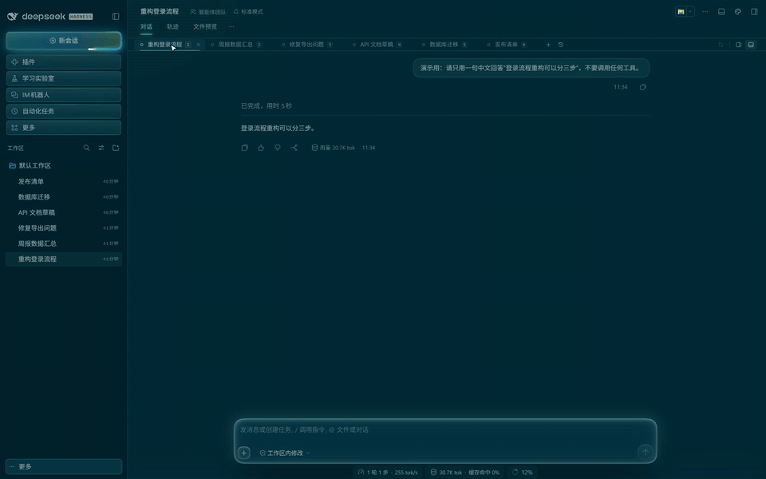

# DSH 多会话标签栏

在 DeepSeek Harness 的一个窗口里，用标签同时打开多个会话。Web 和 Desktop 都能用。

 

录屏来自真实的 DSH Web 界面，会话均为演示用。[高清 MP4](docs/demo.mp4)

> 截图中的界面外观来自同作者的 [翰墨 Hanmo](https://github.com/xiaonerner0821/dsh-hanmo)：磨砂玻璃输入框、新会话按钮彗星动效、8 套配色主题（含 One Dark Pro、Dracula、GitHub 等），以及字体和透明度调节，可以和本插件同时安装（`github:xiaonerner0821/dsh-hanmo#main`）。

## 安装

要求：DSH `^0.2.1-rc.1`，Node.js `>=20`。暂未发布到 npm，请任选下面一种方式安装，装好后刷新页面即可生效。

| 方式 | 在 DSH 插件管理里填写的安装地址 | 适合 |
| --- | --- | --- |
| GitHub 最新版 | `github:xiaonerner0821/dsh-multi-session#main` | 日常使用，跟随 `main` 升级 |
| GitHub 指定版本 | `github:xiaonerner0821/dsh-multi-session#v0.7.1` | 固定在某个发布版本 |
| 发布包 | 从 [Releases](https://github.com/xiaonerner0821/dsh-multi-session/releases) 下载 `.tgz`，填它的绝对路径 | 离线安装 |
| 本地目录 | 克隆本仓库后，填仓库目录的绝对路径 | 开发调试 |

也可以直接在 DSH 会话里对助手说「安装插件 `github:xiaonerner0821/dsh-multi-session#main`」。

- 地址必须带 `github:` 前缀，只写 `xiaonerner0821/dsh-multi-session` 会被当成 npm 包名而安装失败。
- 安装后，插件在插件列表里显示为 `@xiaonerner0821/dsh-multi-session`（这是包名，卸载时用它）。以后发布到 npm 也用这个名字。npm 上不带 scope 的 `dsh-multi-session` 是另一位作者的插件，和本插件无关。
- **从 v0.5.4 及更早版本升级**：旧版本的包名是 `@local/dsh-multi-session`。请先卸载它，再按上面的地址安装。不要两个都装，否则会出现两条标签栏。
- **升级**：从 GitHub 安装时，pnpm 会把插件锁定在安装那一刻的 commit，重启 DSH 不会自动更新。要升级到最新版，先在插件管理里卸载 `@xiaonerner0821/dsh-multi-session`，再用上面的地址重新安装，然后刷新页面。

## 功能

- **两种标签栏位置，可互相切换**：放在 Windows 桌面端的标题栏里（原生菜单右侧、窗口按钮左侧），或者放在会话头部下方。桌面端默认在标题栏；Web 与桌面端的选择分别保存。没有 Windows 标题栏的环境（浏览器、macOS）固定显示在头部下方。
- **标题栏 / 标签栏高度**：标签栏位于桌面端标题栏时，调的是标题栏高度，默认 36px（原生为 40px），范围 30–48px，菜单预设「紧凑 32 / 默认 36 / 原始 40 / 宽松 44」。标签栏位于会话头部下方时（浏览器里总是这种情况），调的是标签栏自身高度，默认 38px，范围 28–52px，菜单预设「紧凑 32 / 默认 38 / 宽松 44 / 特大 50」。两种都可以拖动标签栏底边调整，双击底边恢复默认。
- **固定标签**：右键「固定标签」后，标签移到最左侧的固定组，宽度与普通标签一致，不会被「关闭其他 / 关闭右侧」和中键误关，并且始终常驻内存。图钉图标常驻，点击图钉或右键「取消固定」恢复；悬停时和普通标签一样出现关闭按钮，可直接关闭。
- **标签分组**：给标签分组后，组前面有一个彩色胶囊（组名，未命名时显示标签数），组内标签下方有一条同色细线。8 种颜色，新建分组时自动选用还没被占用的颜色。固定标签视为一个特殊的分组，始终在最左侧，以图钉作为组标识，固定的标签不会再加入别的分组。
  - **新建**：右键标签选「添加到新分组」，或按 Alt+Shift+G；也可以把一个标签拖到另一个未分组标签的中间位置（出现虚线框时松开），两个标签合成一个新分组。
  - **加入 / 移出**：右键标签「添加到分组」，从列表里选（每项前有该组颜色）；或把标签拖到分组胶囊上、拖进组内任意位置。右键「移出分组」或 Alt+Shift+U 移出，把组内标签拖到组外也会移出。用 Shift+← / → 移到组的边缘时，会走出或走进相邻的分组。
  - **折叠**：点击胶囊或按 Alt+Shift+C 折叠，只留胶囊和标签数；组里有标签在运行或等你处理时，胶囊右上角显示状态点。切换标签时会跳过折叠组里的标签；切到折叠组里的会话时，该组自动展开。
  - **分组菜单**（右键胶囊）：重命名（也可双击胶囊或按 F2）、换颜色、折叠 / 展开、在分组中新建标签、分组左移 / 右移、取消分组（标签保留，只解散分组）、关闭分组（关闭组内所有标签）。整个分组也可以拖动胶囊换位置。
  - 关闭标签后从「最近关闭」恢复时，如果原分组还在，会回到原分组。
- **后台标签保持常驻**：通过 `ctx.sessions.retain` 让最近使用的 8 个标签、所有固定标签和正在运行的标签留在内存里，切回来不用重新加载。
- **状态点**：运行中（三根品牌色电平条起伏）、等你审批或回答（琥珀色实心点，周围光晕呼吸）、已完成未读（品牌色实心点，出现时轻弹，带一圈淡光晕）、连接中（三个小点依次波动）、空闲（细空心圆）、未常驻（很淡的小实心点）。
- **悬停滚动标题**：标题被截断时，鼠标移上去立即开始匀速来回滚动显示全文；系统开启「减少动态效果」时不滚动。悬停时显示的编号占位固定，不会改变标签宽度。
- **标签太多时**：右键标签栏空白处，在「标签太多时」里选择「横向滚动」（默认，标签保持原宽度，可用滚轮横向滚动）或「缩小宽度，全部显示」（所有标签同宽，一起缩小以全部放进标签栏；变窄后依次隐藏编号、标题，只留状态点和关闭按钮；缩到最窄仍放不下时才滚动）。所有页面共用这个设置。固定标签与普通标签宽度规则一致。
- **浏览器标签页图标**：在浏览器里使用时，浏览器标签页的图标右下角会叠加整个标签栏里最需要关注的状态（优先级：等你处理 > 运行中 > 已完成未读 > 连接中，静态图形）；所有标签都空闲时恢复原图标。如果当前会话是在浏览器标签页处于后台时完成的，它也算「已完成未读」，切回这个浏览器标签页后清除。底图跟随系统浅色 / 深色模式选用对应的应用图标。桌面端没有浏览器标签页，不做处理。
- **拖拽排序**：拖到哪里会显示插入指示线；把普通标签拖进固定组即固定它，拖出固定组即取消固定。拖到标签栏末尾的空白处会放到最后并离开分组。中键点击普通标签可以关闭它。
- **关闭后回到上一个标签**：关闭当前标签时，切换到最近一次激活过的标签，而不是相邻标签；全部关完则在同一工作区新建会话。
- **右键菜单**：打开、固定/取消固定、重命名、新建；添加到新分组、添加到分组、移出分组；左移、右移；关闭、关闭其他、关闭右侧、恢复最近关闭；标签栏位置与标题栏高度。菜单贴着被点击的标签弹出。
- **重命名**：双击标签或按 F2 就地编辑，写入的是会话的正式标题。

## 快捷键

| 操作 | 按键 |
| --- | --- |
| 切换到上/下一个标签 | Alt+Shift+← / → |
| 跳到第 N 个标签（9 = 最后一个） | Alt+Shift+1…9 |
| 向左/右移动当前标签 | Shift+← / →（输入框、终端里或有文本选区时不拦截） |
| 关闭当前标签 | Alt+Shift+W |
| 恢复最近关闭 | Alt+Shift+T |
| 新建会话 | Alt+Shift+N |
| 当前标签添加到新分组 | Alt+Shift+G |
| 当前标签移出分组 | Alt+Shift+U |
| 折叠 / 展开当前标签所在分组 | Alt+Shift+C |

标签获得焦点时：←/→ 移动焦点，Home/End 到首尾，Enter 切换，Delete 关闭，F2 重命名，Shift+F10 打开菜单。分组胶囊获得焦点时：Enter / 空格折叠或展开，F2 重命名，Shift+F10 打开分组菜单。

这些按键由插件自己监听，不出现在 Harness 的快捷键设置里（Harness 的快捷键注册表在 Web 端不接受不含 Ctrl 的 Alt+Shift 组合）。

## 存储与多个浏览器标签页

- **每个浏览器标签页各管各的**：标签列表、固定、分组、当前会话保存在该页的 `sessionStorage`（`dsh-multi-session.tabs.v3`）。刷新页面后标签栏原样恢复，并回到这个页面刚才显示的会话；在另一个浏览器标签页里切换、关闭标签不会影响这里。
- **新开浏览器标签页**：只要还有其他页面开着，新页面就从空标签栏开始，只跟随自己打开的会话。从链接新开的页面、复制出来的标签页也一样，即使浏览器把原页面的 `sessionStorage` 一起复制了过来。只有所有页面都已正常关闭时（例如浏览器或桌面端重启后的第一个页面），才从最近一次的快照（`dsh-multi-session.snapshot.v3`）恢复。
- **后台页面被浏览器冻结时**：浏览器会冻结或丢弃长时间在后台的标签页，它们不再发心跳，但仍然算作开着（最长 3 天），所以新页面不会误把快照里的整组标签带过来。被丢弃的页面重新激活、按 F5 刷新、崩溃后重新加载时，仍恢复它自己原来的标签。桌面端不会冻结窗口，心跳停止超过 90 秒即视为已关闭。
- **共享内容**：「最近关闭」列表、标签栏位置、标题栏 / 标签栏高度、底部面板显隐保存在 `localStorage`（`dsh-multi-session.prefs.v3`），所有页面共用，一处修改其他已打开页面实时同步。在 A 页关闭的标签可以在 B 页恢复（恢复到 B 页的标签栏）。
- **状态点跨页同步**：「已完成未读」由 DSH 按页面各自记录，插件额外在 `localStorage`（`dsh-multi-session.read.v1`）记下每个会话最后一次被可见页面显示的时间。在 A 页看过的会话，B 页的未读点随之消失；只有在任何页面都没看过时才保留。「等你处理」只有加载了该会话的页面才知道，插件把各页已知的待回答会话写进 `localStorage`（`dsh-multi-session.pending.v1`），其他页面里还没加载的标签也会显示「等你处理」；发布它的页面关闭或心跳超时后，这条记录作废。
- 标签栏在标题栏和会话头部之间切换位置时，会保留各标签上一次的状态，切换瞬间恰好在后台完成的会话依然会记为「已完成未读」。
- 页面存活通过 `localStorage` 里的心跳（`dsh-multi-session.alive.v3`）判断。首次运行会从 v1/v2 迁移数据。
