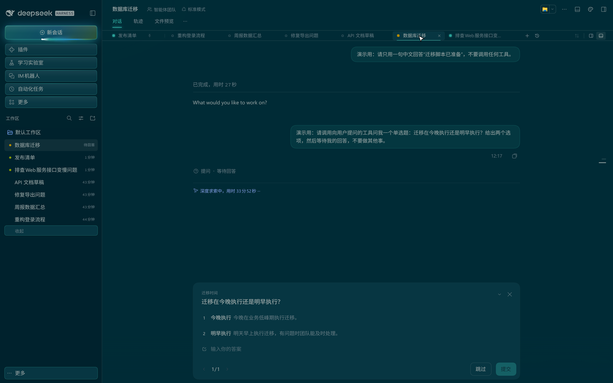

# @local/dsh-multi-session

在 DeepSeek Harness 的一个窗口里，用标签同时打开多个会话。Web 和 Desktop 都能用。

录屏来自真实的 DSH Web 界面，会话均为演示用。[高清 MP4](docs/demo.mp4)

## 安装

暂未发布到 npm。可以从 GitHub 安装：在 DSH 会话里让助手安装插件包 `github:xiaonerner0821/dsh-multi-session`，或从 [Releases](https://github.com/xiaonerner0821/dsh-multi-session/releases) 下载源码包解压后，以本地目录方式安装。安装后刷新页面即可生效。

## 功能

- **两种标签栏位置，可互相切换**：放在 Windows 桌面端的标题栏里（原生菜单右侧、窗口按钮左侧），或者放在会话头部下方。桌面端默认在标题栏；Web 与桌面端的选择分别保存。没有 Windows 标题栏的环境（浏览器、macOS）固定显示在头部下方。
- **标题栏 / 标签栏高度**：标签栏位于桌面端标题栏时，调的是标题栏高度，默认 36px（原生为 40px），范围 30–48px，菜单预设「紧凑 32 / 默认 36 / 原始 40 / 宽松 44」。标签栏位于会话头部下方时（浏览器里总是这种情况），调的是标签栏自身高度，默认 38px，范围 28–52px，菜单预设「紧凑 32 / 默认 38 / 宽松 44 / 特大 50」。两种都可以拖动标签栏底边调整，双击底边恢复默认。
- **固定标签**：右键「固定标签」后，标签移到最左侧的固定组，宽度与普通标签一致，不会被「关闭其他 / 关闭右侧」和中键误关，并且始终常驻内存。图钉图标常驻，点击图钉或右键「取消固定」恢复；悬停时和普通标签一样出现关闭按钮，可直接关闭。
- **后台标签保持常驻**：通过 `ctx.sessions.retain` 让最近使用的 8 个标签、所有固定标签和正在运行的标签留在内存里，切回来不用重新加载。
- **状态点**：运行中（三根品牌色电平条起伏）、等你审批或回答（琥珀色实心点，周围光晕呼吸）、已完成未读（品牌色实心点，出现时轻弹，带一圈淡光晕）、连接中（三个小点依次波动）、空闲（细空心圆）、未常驻（很淡的小实心点）。
- **悬停滚动标题**：标题被截断时，鼠标移上去立即开始匀速来回滚动显示全文；系统开启「减少动态效果」时不滚动。悬停时显示的编号占位固定，不会改变标签宽度。
- **标签太多时**：右键标签栏空白处，在「标签太多时」里选择「横向滚动」（默认，标签保持原宽度，可用滚轮横向滚动）或「缩小宽度，全部显示」（所有标签同宽，一起缩小以全部放进标签栏；变窄后依次隐藏编号、标题，只留状态点和关闭按钮；缩到最窄仍放不下时才滚动）。所有页面共用这个设置。固定标签与普通标签宽度规则一致。
- **浏览器标签页图标**：在浏览器里使用时，浏览器标签页的图标右下角会叠加整个标签栏里最需要关注的状态（优先级：等你处理 > 运行中 > 已完成未读 > 连接中，静态图形）；所有标签都空闲时恢复原图标。如果当前会话是在浏览器标签页处于后台时完成的，它也算「已完成未读」，切回这个浏览器标签页后清除。底图跟随系统浅色 / 深色模式选用对应的应用图标。桌面端没有浏览器标签页，不做处理。
- **拖拽排序**：拖到哪里会显示插入指示线；固定组与普通组之间不能互相拖入。中键点击普通标签可以关闭它。
- **关闭后回到上一个标签**：关闭当前标签时，切换到最近一次激活过的标签，而不是相邻标签；全部关完则在同一工作区新建会话。
- **右键菜单**：打开、固定/取消固定、重命名、新建；左移、右移；关闭、关闭其他、关闭右侧、恢复最近关闭；标签栏位置与标题栏高度。菜单贴着被点击的标签弹出。
- **重命名**：双击标签或按 F2 就地编辑，写入的是会话的正式标题。

## 快捷键

| 操作 | 按键 |
| --- | --- |
| 切换到上/下一个标签 | Alt+Shift+← / → |
| 跳到第 N 个标签（9 = 最后一个） | Alt+Shift+1…9 |
| 向左/右移动当前标签 | Shift+← / →（输入框、终端里或有文本选区时不拦截） |
| 关闭当前标签 | Alt+Shift+W |
| 恢复最近关闭 | Alt+Shift+T |
| 新建会话 | Alt+Shift+N |

标签获得焦点时：←/→ 移动焦点，Home/End 到首尾，Enter 切换，Delete 关闭，F2 重命名，Shift+F10 打开菜单。

这些按键由插件自己监听，不出现在 Harness 的快捷键设置里（Harness 的快捷键注册表在 Web 端不接受不含 Ctrl 的 Alt+Shift 组合）。

## 存储与多个浏览器标签页

- **每个浏览器标签页各管各的**：标签列表、固定、当前会话保存在该页的 `sessionStorage`（`dsh-multi-session.tabs.v3`）。刷新页面后标签栏原样恢复，并回到这个页面刚才显示的会话；在另一个浏览器标签页里切换、关闭标签不会影响这里。
- **新开浏览器标签页**：如果已有其他页面开着，新页面从空标签栏开始，只跟随自己打开的会话；如果是浏览器或桌面端重启后的第一个页面，则从最近一次的快照（`dsh-multi-session.snapshot.v3`）恢复。复制标签页会继承原页面的标签。
- **共享内容**：「最近关闭」列表、标签栏位置、标题栏 / 标签栏高度、底部面板显隐保存在 `localStorage`（`dsh-multi-session.prefs.v3`），所有页面共用，一处修改其他已打开页面实时同步。在 A 页关闭的标签可以在 B 页恢复（恢复到 B 页的标签栏）。
- 页面存活通过 `localStorage` 里的心跳（`dsh-multi-session.alive.v3`）判断。首次运行会从 v1/v2 迁移数据。
